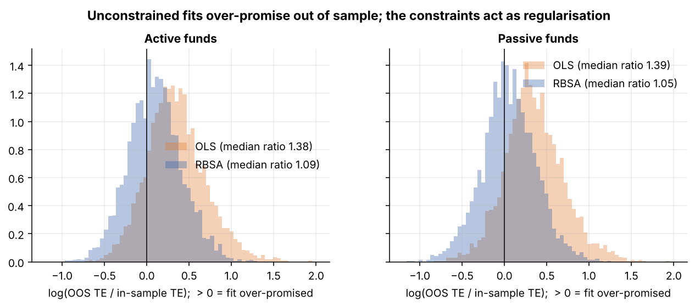
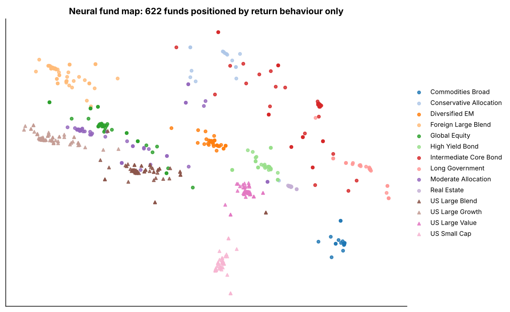
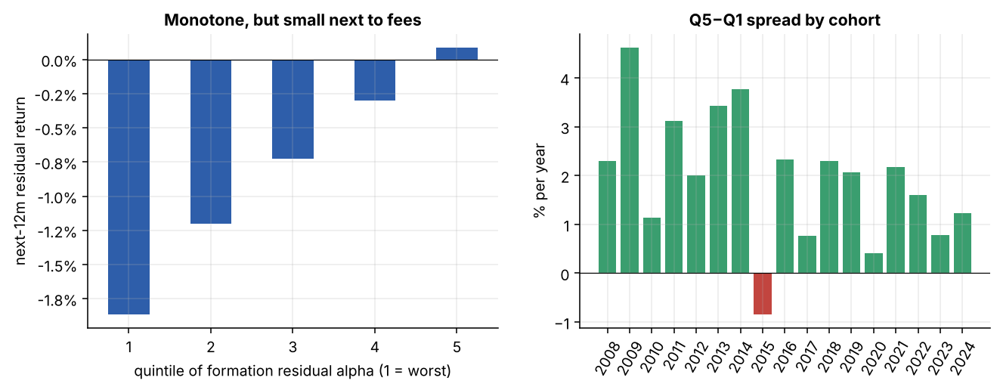
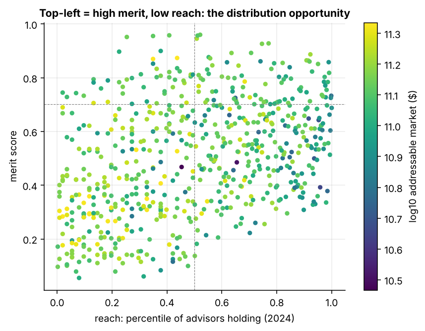
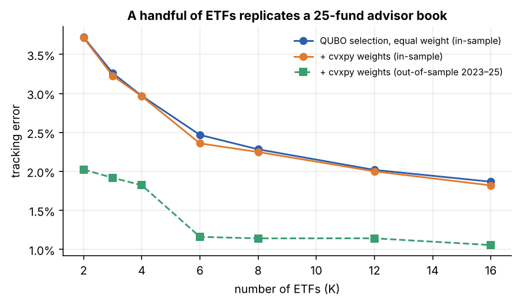

# Fund Intelligence Lab

**Quantitative research on ETFs and mutual funds: decomposition, substitution, persistence, distribution opportunity and portfolio optimisation, with every method validated out of sample.**

Five executed Jupyter notebooks and a small Python package (`pfquant`) that work through the core
problems of an independent fund-research business:

* Which funds can credibly **substitute** for one another?
* How much of a fund's return is **investable exposure** and how much is **residual** performance?
* Does residual alpha **persist**, and does machine learning help predict it?
* Where can a fund compete for **allocations**, and which advisors should hear about it?
* How do you build fund portfolios that hold up **out of sample**, including a **quantum-ready**
  formulation of fund selection?

Statistical significance, multiple testing, out-of-sample evaluation and honest baselines run through
every notebook. Where a neural network does not beat a simple model, the notebook says so.

---

## The notebooks

| # | Notebook | Question | Methods | Headline result |
|---|---|---|---|---|
| 01 | [Fund Decomposition](notebooks/01_fund_decomposition.ipynb) | Investable exposure vs residual alpha? | Returns-based style analysis (constrained regression), rolling windows, Newey–West t-stats, Benjamini–Hochberg FDR, Fama–French cross-sectional bootstrap | Constrained replication keeps its tracking error out of sample (+9 %) while unconstrained OLS degrades (+38 %); constrained wins in 80 % of 9,440 walk-forward fund-years |
| 02 | [Fund Substitution](notebooks/02_fund_substitution.ipynb) | Which funds fill the same portfolio role next period? | Pairwise similarity on ~385k fund pairs, PyTorch MLP and gradient boosting predicting **out-of-sample** tracking error, autoencoder fund map, share-class detection | The in-sample best match is the realised best match for only 16 % of funds; learned rankers beat single heuristics (Spearman 0.88 → 0.91). A 1.34 %-fee fund gets substitutes saving ≈1.1 %/yr |
| 03 | [Performance Persistence](notebooks/03_performance_persistence.ipynb) | Does residual alpha predict residual alpha? | 17 annual cohorts, quintile sorts, transition matrix, horizon decay, walk-forward ridge / gradient boosting / MLP ensemble vs an oracle | Top-minus-bottom alpha quintile ≈ +2 %/yr (NW t ≈ 7); IC decays from 0.14 to ≈0.03 by year 3; ML lifts IC 0.11 → 0.13, far below the oracle's 0.53 |
| 04 | [Fund Opportunity](notebooks/04_fund_opportunity.ipynb) | Where can a fund compete, and with which advisors? | Four-dimension opportunity score (Similar Fund Ranking, Addressable Market, empirical-Bayes Pure Alpha, Diversification Benefit) on 13F/ADV-style holdings; neural two-tower recommender (BPR); LLM brief with numeric guardrail | Flows follow reach, not merit, so the opportunity is the gap: 46 under-distributed high-merit funds. The hybrid recommender's top-50 leads adopt at **4.6×** the base rate |
| 05 | [Optimisation & QUBO](notebooks/05_portfolio_optimization_qubo.ipynb) | How to build fund portfolios robustly, and pick exactly K funds? | Walk-forward min-variance / Ledoit–Wolf / risk parity / alpha tilt with `cvxpy`; vectorised analytics for 400k advisor books; cardinality-constrained replication as a **QUBO**, solved by simulated annealing | Annealer finds the exact optimum in 30/30 verifiable instances (greedy: 9/30); **6 ETFs replicate a 25-fund advisor book at ≈1.2 % out-of-sample tracking error and 0.05 % fees vs 0.62 %** |

Every notebook ends with a **Takeaways** and **Limitations** section.

---

## Highlights

**Constraints make replication robust out of sample (01).**
Unconstrained style regressions fit slightly better in sample and then degrade; the long-only, fully
invested replication is a portfolio an investor can actually buy, and it keeps tracking.



**A neural map of 622 funds, positioned by return behaviour alone (02).**
An autoencoder compresses each fund's 60-month return path into two numbers. Category labels were never
shown to the model.



**Residual alpha persists, then decays (03).**



**Merit versus reach: where the distribution opportunity sits (04).**



**Replicating an advisor book with K ETFs via QUBO (05).**



---

## Why a simulated universe, and how to run on real data

Real fund data never tells you whether a method found the *truth*: nobody knows a fund's true skill or
which funds are genuinely interchangeable. `pfquant.simulate` generates a realistic universe **with known
ground truth**, so every method can be validated rather than just applied:

* 11 investable index factors (US large/growth/value/small, international, EM, aggregate bonds, long
  Treasuries, high yield, REITs, commodities) with a latent correlation structure, fat-tailed shocks and a
  Markov crisis regime;
* 644 funds in 14 Morningstar-style categories: passive and active, ETFs and mutual funds, multiple share
  classes with identical portfolios and different fees, staggered inception dates;
* drifting exposures for active managers, persistent-but-decaying skill with manager changes, transient
  alpha, fee drag and idiosyncratic risk;
* 3,000 advisory firms (RIA, broker-dealer, hybrid, 13F institutional) with latent category, vehicle and
  fee preferences and performance chasing, observed at 2024Q4 and 2025Q4.

**Real data.** Set `USE_REAL_DATA = True` at the top of notebooks 01, 02, 03 or 05 to download monthly
total returns for ~45 real ETFs and mutual funds plus the 11 factor proxies (SPY, IWF, IWD, IWM, EFA, EEM,
AGG, TLT, HYG, VNQ, DBC) from Yahoo Finance via `pfquant.real_data`. Ground-truth checks switch off
automatically. For holdings, `pfquant.sec13f.load_13f_quarter` parses the SEC's quarterly
[Form 13F data sets](https://www.sec.gov/data-research/sec-markets-data/form-13f-data-sets) (keeping the
latest amendment per manager and dropping option positions).

---

## Repository structure

```
├── notebooks/                      executed notebooks, outputs included
│   ├── 01_fund_decomposition.ipynb
│   ├── 02_fund_substitution.ipynb
│   ├── 03_performance_persistence.ipynb
│   ├── 04_fund_opportunity.ipynb
│   └── 05_portfolio_optimization_qubo.ipynb
├── pfquant/                        reusable research code
│   ├── simulate.py                 fund universe + advisor holdings with ground truth
│   ├── stats.py                    RBSA, Newey–West, BH-FDR, block bootstrap, metrics, shrinkage
│   ├── decompose.py                universe-wide decomposition and replication
│   ├── qubo.py                     QUBO builder, simulated annealing, greedy, brute force, dimod export
│   ├── real_data.py                Yahoo Finance loader with the same interface
│   ├── sec13f.py                   SEC Form 13F bulk data-set parser
│   └── plotting.py
├── tests/                          pytest: estimator recovery, FDR, Newey–West, 13F parser, QUBO optimality
├── figures/                        charts saved by the notebooks
└── requirements.txt
```

## Quickstart

```bash
git clone https://github.com/<your-username>/fund-intelligence-lab.git
cd fund-intelligence-lab
python -m venv .venv && source .venv/bin/activate     # Windows: .venv\Scripts\activate
pip install -r requirements.txt
python -m pytest -q                                    # 7 tests, ~1 s
jupyter lab notebooks/
```

Everything runs on a laptop CPU: each notebook takes 15–60 seconds. Seeds are fixed, so results reproduce.
Re-execute all notebooks in place with
`jupyter nbconvert --to notebook --execute --inplace notebooks/*.ipynb`.

---

## Methods and references

* **Returns-based style analysis**: Sharpe (1992), *Asset allocation: management style and performance measurement*. Solved here as non-negative least squares with an exact-budget row, ~100× faster than a generic QP.
* **Skill vs luck**: Fama & French (2010), *Luck versus skill in the cross-section of mutual fund returns*; Barras, Scaillet & Wermers (2010) on false discoveries; Benjamini & Hochberg (1995).
* **Persistence**: Carhart (1997), *On persistence in mutual fund performance*; Newey & West (1987) standard errors.
* **Shrinkage**: Ledoit & Wolf (2004) covariance; empirical-Bayes shrinkage of alpha estimates.
* **Constrained portfolios**: Jagannathan & Ma (2003), *Risk reduction in large portfolios: why imposing the wrong constraints helps*; Spinu (2013) convex risk parity.
* **Recommenders**: Rendle et al. (2009), *BPR: Bayesian personalized ranking from implicit feedback*; two-tower retrieval models.
* **QUBO and quantum optimisation**: Lucas (2014), *Ising formulations of many NP problems*; Farhi, Goldstone & Gutmann (2014), QAOA.

## Limitations and next steps

* Simulated data validates methods; it does not prove that the effect sizes hold in real markets. The
  real-data switch is the next step, with survivorship-bias-free fund data (e.g. CRSP) for persistence work.
* Substitution uses returns only; adding holdings overlap from N-PORT filings would sharpen it.
* 13F covers institutional managers and ETFs, not advisor-level mutual fund positions; Form ADV/IAPD and
  platform data fill that gap.
* The QUBO section benchmarks a classical annealer; running the exported model on D-Wave or QAOA hardware
  is a natural extension.

---

## About

Built by **Rqm Akhmitzyanov** · [LinkedIn](www.linkedin.com/in/ram-akhmitzyanov-8479a56b) · [email](arramzis@gmail.com)

Background: *PhD Mathematics, Statistics | AWS • Databricks | Deep ML • Reinforcement Learning | Agentic AI  | Knowledge Graphs • better process decisions*

Licensed under the MIT License.
